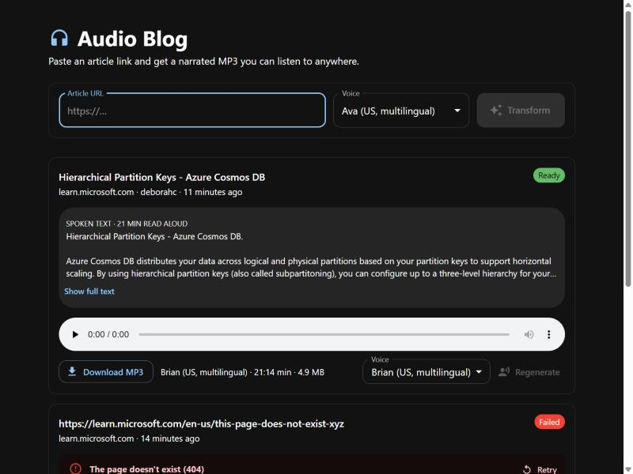

# Audio Blog: a test of the Azure Cosmos DB Agent Kit

> **This repository is a test of the [Azure Cosmos DB Agent Kit](https://github.com/AzureCosmosDB/cosmosdb-agent-kit).**
> A coding agent (Claude Code) built a small real-world app on Azure Cosmos DB, first **without** the kit, then reviewed and improved it **with** the kit's `cosmosdb-best-practices` skill. This README follows the steps of the test and records what happened at each one.



## Test status at a glance

| # | Step | Status | Result |
|---|---|---|---|
| 1 | Pick a small real-world app where Cosmos DB fits | ✅ | **Audio Blog**: turns an article URL into an MP3 |
| 2 | Write your own prompt for a coding agent | ✅ | [One prompt](#step-2-the-prompt), written the way I'd normally write one |
| 3 | First attempt without Azure MCP tools or agent kit skills | ✅ | Plain Claude Code, no Azure MCP server, no Cosmos DB skill |
| 4 | Let the agent generate the app | ✅ | Complete solution in one go: API, worker, frontend, Bicep, tests |
| 5 | Install dependencies, build, run tests, start the app | ✅ | Built, 33/33 tests passed, ran locally end to end |
| 6 | Record whether it built and ran, plus errors and confusing setup | ✅ | [Two follow-ups needed](#step-6-what-worked-and-what-didnt), both about AI and Azure sign-in, none about Cosmos DB |
| 7 | Enable or install the agent kit skills | ✅ | `cosmosdb-best-practices` installed into `.claude/skills` |
| 8 | Ask the agent to review for Cosmos DB best practices | ✅ | [5 main suggestions + 4 minor](#step-8-what-the-cosmos-db-review-suggested) |

---

## How the run was set up

| Item | Setup |
|---|---|
| **Coding agent** | Claude Code, desktop app, Windows 11 |
| **Round 1 tools** | Claude Code's built-in tools only. **No** Azure MCP server, **no** Cosmos DB agent kit skill, no other Cosmos DB plugin. |
| **Round 2 tools** | Same agent plus the agent kit's `cosmosdb-best-practices` skill. A **fresh** session, so it has no memory of round 1. |
| **Cosmos DB** | Local **Cosmos DB emulator (vNext, Linux, Docker)**. No Azure Cosmos DB account was used. |
| **Blob Storage** | Local **Azurite** emulator (Docker) |
| **AI models** | Azure OpenAI (`gpt-5.4-mini`) and Azure AI Speech, **in Azure**, deployed with a small AI-only Bicep. There is no local stand-in for them. |
| **App processes** | API, worker and frontend run locally with `dotnet run` and `npm run dev` |
| **Machine prerequisites** | .NET 10 SDK, Node.js 22+, Docker Desktop, Azure CLI (`az login`), PowerShell 7 |

The full Azure deployment (`infra/main.bicep`, `scripts/deploy.ps1`, with Container Apps, Static Web Apps and a real serverless Cosmos DB account) was generated, but it has **not** been deployed in this test. Everything Cosmos DB related ran against the emulator.

---

## Step 1: The app

**Audio Blog.** Paste an article URL, click **Transform**, and get back an MP3 of the article, rewritten so it sounds natural when read aloud.

Why it's a fair test for Cosmos DB:

- **Small enough** to build in one prompt.
- **Cosmos DB is the only database**, so it has to hold the article list, processing state, intermediate text and the work queue.
- **Hard reliability requirements:** async processing, crash safety, no duplicates, retries, resume from the failed step. That forces real design decisions (data model, partition key, concurrency control, scheduling), not just CRUD.
- **A cost limit** of a few euros a month, so RU cost and throughput mode matter.

| Part | Technology |
|---|---|
| Backend | .NET 10: ASP.NET Core minimal API plus a separate background worker |
| Frontend | React, Vite, TypeScript, Material UI |
| Database | Azure Cosmos DB for NoSQL |
| AI | Azure OpenAI rewrites the text into spoken prose; Azure AI Speech produces the neural TTS |
| Files | Azure Blob Storage, private, served through short-lived SAS URLs |
| Hosting | Azure Container Apps (API, worker), Azure Static Web Apps (frontend), Bicep |
| Auth to Azure | Managed identities and `DefaultAzureCredential` only; key-based auth disabled everywhere |

## Step 2: The prompt

This is the only prompt used to generate the app. It has the level of detail I'd normally give a coding agent: fixed tech stack, user flow, pipeline, reliability and cost requirements. It does **not** say how to model the data in Cosmos DB; that was left to the agent.

<details>
<summary><b>Show the prompt</b></summary>

```markdown
# Build: "Audio Blog" – turn any article URL into an MP3

## Goal
A small web app where I paste an article URL, click "Transform", and get back
a listenable MP3 of that article, rewritten so it sounds natural when spoken.

## Tech stack (fixed)
- Backend: .NET (latest LTS), ASP.NET Core minimal API + a separate background worker service
- Frontend: React + Vite + TypeScript, Material UI, kept simple
- Database: Azure Cosmos DB for NoSQL – the ONLY database
- AI: Azure OpenAI (text rewrite), Azure AI Speech (neural TTS)
- File storage: Azure Blob Storage for the MP3 files
- Hosting: API + worker on Azure Container Apps, frontend on Azure Static Web Apps
- Auth to Azure services: managed identity / DefaultAzureCredential, no keys in code
- Infrastructure as code: Bicep

## User flow
1. User pastes a URL and clicks "Transform"
2. A card appears immediately showing the URL and a progress state
3. The card updates through these states: "Reading article…" → "Generating audio…" → "Ready"
4. Once the text is ready, show a preview of the spoken text
5. When done, show an audio player + download button
6. On failure, show a human-readable reason (e.g. "Page needs JavaScript",
   "Article is behind a paywall") and a Retry button
7. A list of all previous articles with their status, newest first

## Processing pipeline
1. Fetch the page HTML in our own code (the AI must NOT browse the URL itself)
2. Extract the main article text using SmartReader (NuGet)
3. Rewrite the text with Azure OpenAI into plain spoken prose: no tables, lists,
   code or image references – describe them in sentences instead
4. Convert the text to speech with Azure AI Speech
5. Store the MP3 in Blob Storage, keep the blob private, serve it to the browser via short-lived SAS

## Reliability requirements (important)
- The API must respond instantly; all processing happens asynchronously in the worker
- Saving the article and scheduling its processing must never get out of sync:
  no article stuck forever without being processed, no processing without an article
- The worker may crash at any point; after restart, work must continue where it left off
- Processing an article twice must never produce duplicate audio or corrupt data
- Transient failures (timeouts, 429, 5xx) are retried automatically, max 3 attempts;
  permanent failures (404, paywall, empty page) fail immediately
- One broken article must never block processing of other articles
- Store which step failed and why, so the UI can show it and Retry resumes from that step
- Re-generating audio with a different voice must not require fetching the page again

## Cost
- Hobby project, single user, should cost only a few euros per month when idle

## Deliverables
- Working solution: API, worker, frontend, Bicep
- Runs locally (document emulators / local setup)
- README explaining: the Cosmos DB data model (containers, item shapes, keys)
  and WHY you designed it that way, plus how each reliability requirement is met
```

</details>

## Step 3: First attempt without MCP tools or skills

Round 1 ran in a plain Claude Code session in this folder. No Azure MCP server and no Cosmos DB agent kit skill were enabled, so every Cosmos DB decision came only from the model's own knowledge.

## Step 4: What the agent generated

From the single prompt, the agent produced the whole solution:

- `src/AudioBlog.Api`: minimal API
- `src/AudioBlog.Worker`: background worker (change feed plus a sweep for due work)
- `src/AudioBlog.Core`: domain, Cosmos DB data access, pipeline (extract, rewrite, synthesize), Blob storage
- `tests/AudioBlog.Tests`: unit tests
- `web/`: React frontend
- `infra/`: Bicep for Cosmos DB (serverless), Storage, AI, Container Apps, Static Web Apps
- `docker-compose.yml`: Cosmos DB emulator and Azurite
- [`docs/DESIGN.md`](docs/DESIGN.md): the data model, why it was designed that way, and how each reliability requirement is met

The Cosmos DB design it chose on its own:

- **Partition key:** hierarchical `[userId, articleId]`. All items of one article share a logical partition, so step output and status can be written in one transactional batch.
- **Item types:** a small, frequently updated `article` status item, separate from the large `source` and `script` text items.
- **Concurrency:** ETag checks on every read-modify-write, plus leases so two workers can't process the same article.
- **Scheduling:** "save + schedule" is one write (`dueAt` on the article). The worker picks work up through the change feed, with a periodic sweep as a safety net.
- **Indexing:** exclude `/*`, include only the queried paths, plus a composite index for the article list.
- **SDK:** one singleton `CosmosClient`, Direct mode in Azure, Gateway mode against the emulator.

## Step 5: Install, build, test, run

These are the commands used. They are also how you run it yourself.

**1. Start the emulators** (Cosmos DB vNext emulator on https://localhost:8081, Data Explorer on http://localhost:1234, Azurite on port 10000):

```bash
docker compose up -d
```

**2. Deploy the AI models to Azure and grant your `az login` user access** (creates the resource group `rg-audioblog-ai`, no keys):

```bash
pwsh ./scripts/setup-local-ai.ps1
```

**3. Build and run the tests:**

```bash
dotnet build AudioBlog.slnx
```

```bash
dotnet test AudioBlog.slnx
```

**4. Start the API, the worker and the frontend**, each in its own terminal:

```bash
dotnet run --project src/AudioBlog.Api
```

```bash
dotnet run --project src/AudioBlog.Worker
```

```bash
npm --prefix web install && npm --prefix web run dev
```

Then open http://localhost:5173 and transform an article.

The containers and the database are created on startup (`EnsureCreated` in `appsettings.Development.json`), so no manual setup in the emulator is needed. Both AI services are pay-per-use with no idle cost. Remove them afterwards with:

```bash
az group delete --name rg-audioblog-ai
```

## Step 6: What worked and what didn't

**Result of round 1:** the generated code **built on the first try**, **all 33 unit tests passed**, and the app **ran locally end to end** against the Cosmos DB emulator. The Cosmos DB part worked without any fixes.

It took **one prompt plus two follow-ups** to get real audio out of it. Neither follow-up was about Cosmos DB:

| # | Problem | Cause | Fix |
|---|---|---|---|
| 1 | **The MP3 was silent.** The pipeline ran through all states to "Ready", but the audio had no speech. | Locally the worker ran in the built-in offline `Fake` AI mode (`"AiMode": "Fake"` in `appsettings.Development.json`). There is no local emulator for Azure OpenAI or Speech, so the fake produces silence of the right length. | Follow-up 1: the agent added an AI-only Bicep ([`infra/ai-only.bicep`](infra/ai-only.bicep)) and [`scripts/setup-local-ai.ps1`](scripts/setup-local-ai.ps1), which deploy just the two AI services and write a git-ignored `appsettings.Local.json` that switches the worker to them. |
| 2 | **Azure sign-in failed locally** with `AuthenticationFailedException: ManagedIdentityCredential authentication failed: All Managed Identity sources are unavailable`. | `DefaultAzureCredential` tried managed identity first, which doesn't exist on a laptop. | Follow-up 2: managed identity and workload identity are now only used when a client ID is configured ([`ServiceCollectionExtensions.cs:53`](src/AudioBlog.Core/ServiceCollectionExtensions.cs:53)), so locally it falls through to the Azure CLI login. |

## Step 7: Installing the agent kit

The `cosmosdb-best-practices` skill (100+ rules in 12 categories: data modeling, partition keys, queries, SDK, indexing, throughput, …) was installed into `.claude/skills/cosmosdb-best-practices` and pinned in `skills-lock.json`:

```bash
npx skills add AzureCosmosDB/cosmosdb-agent-kit --skill cosmosdb-best-practices --agent claude-code --copy -y
```

Inside Claude Code you can instead run `/plugin install cosmosdb@claude-plugins-official`, the kit's official Claude Code install. No Azure MCP server was added; only the skill.

## Step 8: What the Cosmos DB review suggested

A fresh Claude Code session reviewed the baseline with the skill.

**What the review kept as-is.** The baseline already followed most of the kit's rules:

- **Partition key:** hierarchical `[userId, articleId]`. All items of one article share a logical partition (transactional batch), and "list my articles" is a single-prefix query, not a fan-out.
- **Reads and writes:** point reads for everything addressed by id, a transactional batch for step output + status, ETag checks on every read-modify-write.
- **SDK:** one singleton `CosmosClient` in Direct mode, enums stored as strings, fixed-width UTC timestamps, `EnableContentResponseOnWrite = false` where the response isn't needed.
- **Data model:** the small, frequently updated status item is kept apart from the large text items.
- **Indexing:** exclude `/*`, include only the queried paths.
- **Security:** Entra ID only, `disableLocalAuth: true`.

**Suggestions, highest impact first:**

| # | Suggestion | Where | Why |
|---|---|---|---|
| 1 | **Make the list query use its composite index.** Change `ORDER BY c.createdAt DESC` to `ORDER BY c.userId ASC, c.type ASC, c.createdAt DESC`. | [`CosmosArticleStore.cs:85`](src/AudioBlog.Core/Data/CosmosArticleStore.cs:85) | Cosmos DB only uses a composite index for filter + sort when the equality-filtered fields come first in `ORDER BY`. As written, the query falls back to the single-field `createdAt` index and filters afterwards. The result order doesn't change (both fields are constant after the filter). This is the busiest query: the UI polls it every 2 s while an article is processing. |
| 2 | **Log Cosmos diagnostics and RU charges.** Set `CosmosClientTelemetryOptions` with `CosmosThresholdOptions`, enable distributed tracing / OpenTelemetry, and keep the inner `CosmosException` (or its diagnostics) on `ConcurrencyException` and `CosmosBatchException`. | [`CosmosSetup.cs`](src/AudioBlog.Core/Data/CosmosSetup.cs), [`CosmosArticleStore.cs:51`](src/AudioBlog.Core/Data/CosmosArticleStore.cs:51), [`:73`](src/AudioBlog.Core/Data/CosmosArticleStore.cs:73) | Nothing records diagnostics, request charges or slow requests today, and the custom exceptions throw the diagnostics away. Without them you can't tell throttling, retries, fan-out and network latency apart, or measure the effect of #1. |
| 3 | **Make the background cross-partition queries cheaper.** Replace the `COUNT` in `CountPendingAsync` with `SELECT TOP 1 VALUE 1 … WHERE c.type = @type AND IS_DEFINED(c.dueAt)`, or drop the query and use the dispatcher's in-memory state plus the last sweep result. In `QueryDueAsync`, set `MaxItemCount = maxItems` so a page can't go past the limit. | [`CosmosArticleStore.cs:99-128`](src/AudioBlog.Core/Data/CosmosArticleStore.cs:99) | The keep-alive only needs yes/no but counts every pending article every 60 s. Both loops fan out to every physical partition around the clock, and on serverless every request is billed. Small today, grows as data spreads over more partitions. |
| 4 | **Add a schema version to every document.** `"schemaVersion": 1` on article, source and script items. | [`Documents.cs`](src/AudioBlog.Core/Domain/Documents.cs) | `ArticleDocument` has already changed shape several times (`Steps`, `Progress`, `Lease`, `Failure`). Stored documents keep their old shape, and old workers can still run during a deployment. A version field allows gradual or on-read migration instead of guessing from missing fields. |
| 5 | **Keep the indexing policy in sync between Bicep and code.** After startup, read the container, compare the composite indexes and call `ReplaceContainerAsync` if they differ, or keep one shared source for the policy. | [`CosmosSetup.cs`](src/AudioBlog.Core/Data/CosmosSetup.cs), [`cosmos.bicep`](infra/modules/cosmos.bicep) | `CreateContainerIfNotExistsAsync` ignores the indexing policy for an existing container, so an emulator container from an older schema keeps its old indexes. The two definitions have already drifted: Bicep excludes `/"_etag"/?`, the C# version doesn't. |

**Lower priority:**

- **Patch instead of Replace for progress updates.** [`ArticleProcessor.cs:191-200`](src/AudioBlog.Core/Pipeline/ArticleProcessor.cs:191) rewrites the whole article for every speech chunk. `PatchItemAsync` on `/progress` with `IfMatchEtag` sends less and states what changed. The RU saving is small because the document is small.
- **Project fields in the list query.** `SELECT *` also returns `lease`, `dueAt`, `failure.detail` and step bookkeeping the DTO never uses. Small gain, mostly tidier.
- **429 retry settings.** The values in [`CosmosSetup.cs`](src/AudioBlog.Core/Data/CosmosSetup.cs) equal the SDK defaults, so they change nothing. Harmless.
- **Availability.** One region, no zone redundancy, no `ApplicationRegion`. Fine for a hobby app on serverless; if it grows, zone redundancy is the cheapest first step.
