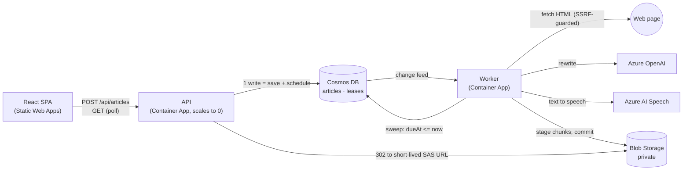

# Audio Blog – design and operations

## Architecture



The pipeline has three resumable steps. Each step persists its output before the article moves on:

| Step | Does | Persists (atomically with the state change) |
|---|---|---|
| `extract` | Fetches the HTML in our own code, then SmartReader extracts the article; headings, lists, tables, code and images are marked up | `source` item |
| `rewrite` | Azure OpenAI rewrites it into plain spoken prose. Tables, lists, code and images become sentences. | `script` item |
| `synthesize` | Azure AI Speech converts the script chunk by chunk; each chunk is staged as a block of the final MP3, then the block list is committed | blob plus `audio` on the article |

The UI shows three phases. **Reading article…** covers extract and rewrite, **Generating audio…** covers synthesize (with "part n of m"), then **Ready**. The spoken-text preview appears as soon as the rewrite is committed.

---

## Run it locally

**Prerequisites:** .NET 10 SDK, Node.js 22 or newer, Docker.

```bash
docker compose up -d
```

```bash
dotnet run --project src/AudioBlog.Api
```

```bash
dotnet run --project src/AudioBlog.Worker
```

```bash
npm --prefix web install
```

```bash
npm --prefix web run dev
```

Open http://localhost:5173.

| Component | Local address | Notes |
|---|---|---|
| Frontend (Vite) | http://localhost:5173 | proxies `/api` to the API, so no CORS setup is needed |
| API | http://localhost:5250 | |
| Worker | http://localhost:5251 | only `/healthz` and `/wake` |
| Cosmos DB emulator (vNext, Linux) | https://localhost:8081 | Data Explorer at http://localhost:1234 |
| Azurite (Blob) | http://127.0.0.1:10000 | |

The API and worker create the database, containers and blob container on startup in Development (`EnsureCreated`). In Azure, Bicep owns them.

### AI modes

`appsettings.Development.json` sets `App:AiMode = Fake`, so the full pipeline runs offline with no Azure account:

- **Fake rewrite:** strips the structure markers and replaces tables and code with a placeholder sentence.
- **Fake TTS:** returns a valid, silent MP3 with a realistic length (about 15 characters per second).

Fetching, extraction, Cosmos DB, Blob Storage, retries, leases and crash recovery all behave exactly as in production.

To hear **real narration** locally, create only the AI services in Azure. They have no idle cost; you pay per article. Then restart the worker:

```powershell
./scripts/setup-local-ai.ps1
```

The script:

1. deploys `infra/ai-only.bicep`, which creates Azure OpenAI and Speech in `rg-audioblog-ai`, Sweden Central
2. gives your signed-in user the *Cognitive Services OpenAI User* and *Speech User* roles
3. writes the git-ignored `src/AudioBlog.Worker/appsettings.Local.json`, which switches the worker to `AiMode=Azure`

Authentication is your `az login`, through `DefaultAzureCredential`. Locally the managed-identity probe is skipped because `AZURE_CLIENT_ID` isn't set. Everything else stays on the emulators.

To remove the services again, delete the resource group:

```powershell
az group delete --name rg-audioblog-ai
```

### Emulator notes

- The .NET SDK cannot talk to the vNext emulator over plain HTTP, so `docker-compose.yml` starts it with `--protocol https`, and the local connection string sets `DisableServerCertificateValidation=True`.
- The emulator's well-known key in `appsettings.Development.json` is not a secret; the vNext emulator doesn't enforce authentication. Azure uses Entra ID only (`disableLocalAuth: true`).
- The vNext emulator accepts the indexing policy but doesn't apply range or composite indexes yet. It also ignores `MaxItemCount` on `ORDER BY` queries, so the list returns all items in one page. Real Cosmos DB pages correctly.

### Tests

```bash
dotnet test
```

34 unit tests cover the processor state machine against an in-memory store with Cosmos DB semantics (ETags, conflict on create, atomic batch):

- retries with back-off and the 3-attempt limit
- permanent failures failing immediately
- Retry resuming at the failed step without fetching again
- voice change reusing the spoken text
- chunk-level resume
- lease-expiry recovery and the crash-loop bound
- lost ownership writing nothing
- idempotent create
- extraction classification (JavaScript-only, paywall, bot wall, empty), chunking, SSRF guard, SSML escaping and the JSON item shape

The crash scenarios were also exercised end to end against the emulators. A worker was killed (`taskkill /F`) mid-synthesis, and after the lease expired a fresh worker logged `Resuming synthesis …: 2/14 chunks already uploaded`. Azurite then held exactly one MP3 per article.

---

## Deploy to Azure

**Prerequisites:** Azure CLI (logged in), PowerShell 7, Node.js.

```powershell
./scripts/deploy.ps1 -ResourceGroup rg-audioblog
```

The script runs in four phases:

1. **Bicep with `deployApps=false`:** Cosmos DB, Storage, Azure OpenAI and Speech, the container registry, the Static Web App, managed identities and role assignments.
2. **`az acr build`:** builds the API and worker images inside the registry, so no local Docker is needed.
3. **Bicep with `deployApps=true`:** the Container Apps environment and both apps, using the new image tags. The API's CORS origin is the Static Web App's hostname.
4. **Frontend:** built with `VITE_API_BASE_URL` set to the API URL and uploaded with the SWA CLI. The deployment token is read at deploy time and never stored.

| Switch | Effect |
|---|---|
| `-WorkerScaleToZero` | The worker sleeps when idle (cheaper, see [Cost](#cost)) |
| `-CosmosFreeTier` | Uses the Cosmos DB free tier instead of serverless (one free-tier account per subscription) |
| `-GrantMeAccess` | Also gives your user data-plane access, for running locally against Azure |
| `-Location`, `-AiLocation`, `-StaticWebAppLocation` | Regions (defaults: `westeurope`, `swedencentral`, `westeurope`) |

The model is a Bicep parameter: `chatModelName`, default `gpt-5.4-mini` version `2026-03-17`, deployed as GlobalStandard. The code passes no `temperature` and uses `max_completion_tokens`, so any current chat model works.

---

## Cosmos DB data model and why

### Containers

| Container | Partition key | Contents |
|---|---|---|
| `articles` | **hierarchical** `[/userId, /articleId]` | three item types: `article`, `source`, `script` |
| `leases` | `/id` | change feed processor checkpoints (managed by the SDK) |

Database `audioblog`. Serverless by default; the free tier is optional, sharing 1000 RU/s at database level.

### Item shapes

All items of one article share the same logical partition (`userId` + `articleId`).

**`article`** is the small, frequently updated status document. It is both the UI's card and the durable work item.

```jsonc
{
  "id": "11111111-1111-1111-1111-111111111111",      // = articleId, generated by the browser (idempotent POST)
  "userId": "me",                                    // single-user today; first level of the partition key
  "articleId": "11111111-1111-1111-1111-111111111111",
  "type": "article",
  "url": "https://learn.microsoft.com/en-us/azure/cosmos-db/change-feed",
  "title": "Work with the Change Feed - Azure Cosmos DB",
  "siteName": "learn.microsoft.com",
  "byline": "jcocchi",
  "status": "ready",                                 // queued | processing | ready | failed
  "step": "synthesize",                              // current / next step: extract | rewrite | synthesize
  "voice": "en-GB-RyanNeural",
  "steps": {                                         // per-step bookkeeping
    "extract":    { "status": "succeeded", "attempts": 1, "startedAt": "…", "completedAt": "…" },
    "rewrite":    { "status": "succeeded", "attempts": 1, "startedAt": "…", "completedAt": "…" },
    "synthesize": { "status": "succeeded", "attempts": 2, "startedAt": "…", "completedAt": "…" }
  },
  "spokenPreview": "Work with the Change Feed - Azure Cosmos DB.\n\nThe change feed in Azure Cosmos DB…",
  "sourceChars": 9603,
  "spokenChars": 6986,
  "audio": {
    "blobName": "me/11111111-…/3f92c33831c55136-en-GB-RyanNeural.mp3",
    "voice": "en-GB-RyanNeural",
    "scriptHash": "3f92c338…",
    "sizeBytes": 1860576,
    "durationSeconds": 465.1,
    "createdAt": "2026-10-20T18:34:48.2905634Z"
  },
  "createdAt": "2026-10-20T18:29:49.3366737Z",
  "updatedAt": "2026-10-20T18:34:48.2910653Z",
  "_etag": "…"
  // while work is pending, there are also:
  //   "dueAt": "2026-…Z"                                when a worker should look at it next
  //   "lease": { "owner": "host:pid:…", "expiresAt": "…" }  while a worker owns it
  // after a failure:
  //   "failure": { "step": "extract", "code": "paywall", "message": "Article is behind a paywall",
  //                "detail": "isAccessibleForFree: false", "transient": false, "at": "…" }
  // during synthesis:
  //   "progress": { "done": 3, "total": 7 }
}
```

**`source`** is the output of `extract`. It is written once per extraction.

```jsonc
{
  "id": "11111111-…:source", "userId": "me", "articleId": "11111111-…", "type": "source",
  "title": "…", "byline": "…", "language": "en-us", "finalUrl": "https://…",
  "text": "## Heading\n\nParagraph…\n\n- list item\n\n[Table]\n| Plan | Price |\n…[/Table]\n\n[Image: alt text]",
  "truncated": false,
  "contentHash": "59af47e5…",          // sha256 of text
  "createdAt": "…"
}
```

**`script`** is the output of `rewrite`: the text that is read aloud.

```jsonc
{
  "id": "11111111-…:script", "userId": "me", "articleId": "11111111-…", "type": "script",
  "text": "Work with the Change Feed - Azure Cosmos DB.\n\nThe change feed in Azure Cosmos DB is…",
  "sourceHash": "59af47e5…",           // which source it was made from
  "scriptHash": "3f92c338…",           // part of the audio blob name
  "model": "gpt-5.4-mini",
  "createdAt": "…"
}
```

### Why it is designed this way

**Start from the access patterns.**

| # | Access pattern | Frequency | Operation |
|---|---|---|---|
| 1 | Create article (and schedule it) | per submit | `CreateItem`, one partition |
| 2 | Show and poll a card | every 2 s while busy | **point read** `(id, [userId, articleId])`, or the list below |
| 3 | List my articles, newest first | page load, polling | `WHERE userId=@u AND type='article' ORDER BY createdAt DESC`, **scoped to the `userId` prefix**, composite index `(userId, type, createdAt DESC)` |
| 4 | Worker reads a step's input | per step | point read of `{id}:source` / `{id}:script` |
| 5 | Worker commits a step | per step | **transactional batch**: upsert output plus ETag-checked replace of `article` |
| 6 | Worker learns about new or changed work | continuous | **change feed** of `articles` |
| 7 | Worker finds due work (retries, expired leases) | every 15 s | `WHERE type='article' AND dueAt <= @now`, composite index `(type, dueAt)` |
| 8 | Re-generate with another voice | per click | ETag-checked replace of `article`; then point read of `script` (no fetch, no rewrite) |

**One container, three item types, one logical partition per article.** Cosmos DB transactions (transactional batch) only span one logical partition of one container. Putting an article's status item and its step outputs in the same container and logical partition means "the text was extracted" and "the article moved on to rewrite" are committed **together or not at all**. A crash can never leave an output without the state change, or a state change without its output. The change feed of that one container is also the single event stream the worker listens to.

**Status item separate from the big text items.** The `article` item is written 10–30 times per article: claim, progress per TTS chunk, lease heartbeats, completion. Cosmos DB charges write RUs by item size and re-indexes the whole item. Keeping it at about 2–3 KB keeps every write cheap. The texts (up to about 60k characters) are written once and are never touched by status updates. It also keeps every item far below the 2 MB item limit, and the list query never drags article bodies along.

**Hierarchical partition key `[/userId, /articleId]`** instead of the alternatives:

| Option | Problem |
|---|---|
| `/id` (article id) | "List my articles" becomes a cross-partition fan-out query |
| `/userId` | All of a user's data in one logical partition, with a hard 20 GB cap; one hot partition |
| **`[/userId, /articleId]`** | List is a **targeted prefix query** on `userId`; the full key per article gives unlimited growth (no 20 GB cap per user) and the right transaction scope (one article) |

Today `userId` is the constant `"me"` (single user). The key is ready for multi-user auth without migrating data.

**Ids are deterministic.** The article id is a UUID generated by the browser, so a retried POST cannot create a duplicate: `CreateItem` returns 409 and the API returns the existing article. Step outputs are `{articleId}:source` and `{articleId}:script`, so re-running a step overwrites instead of duplicating.

**Scheduling state lives in the item, as two fields.**

- `dueAt` means "a worker should look at this at or after this time". It is `now` for new work, the retry time after a transient error, and the lease expiry while processing.
- It is **removed** when the article is Ready or Failed, so the scheduler query never touches finished articles, and the sparse field keeps the index small.
- `lease { owner, expiresAt }` plus the item's `_etag` turn the item into a crash-safe, mutually exclusive work claim without any separate lock service.

**Timestamps are fixed-width UTC strings** (`yyyy-MM-ddTHH:mm:ss.fffffffZ`, the Cosmos DB recommended format), because `createdAt` and `dueAt` are compared and sorted as strings inside queries.

**Indexing policy:**

- Only `/userId`, `/type`, `/createdAt` and `/dueAt` are indexed, plus the two composite indexes. Everything else, including the large `text` fields, is excluded.
- Writes of big items stay cheap.
- Every query in the app is served by an index.

**No second messaging system.** A queue (Service Bus or Storage Queue) next to Cosmos DB would create a dual-write problem ("saved but not enqueued" or "enqueued but not saved") and need an outbox to fix it. The Cosmos DB change feed *is* that outbox: every committed write appears on it, in order, durably.

**Other choices:**

- **Serverless:** pay per request, no minimum. A single-user app is idle almost all the time.
- **Session consistency:** read-your-own-writes for each client. Correctness under concurrency comes from ETags, not from stronger consistency.
- **Audio in Blob Storage, not Cosmos DB:** MP3s are large binaries. The `article` item stores only the blob name, size and duration.

---

## How each reliability requirement is met

### "The API must respond instantly; all processing happens asynchronously in the worker"

`POST /api/articles` validates the URL and does **one** `CreateItem` (25 ms measured locally), then returns `201` with the article. No fetching or AI happens in the request. Retry and change-voice are likewise a single conditional replace. In scale-to-zero mode, the wake-up call to the worker is fire-and-forget.

### "Saving the article and scheduling its processing must never get out of sync"

- **The save is the schedule.** Creating the item with `status=queued, dueAt=now` is the only thing the API does, and it is a single atomic write. There is no second system to write to, so there is no dual-write to get out of sync.
- **Two independent ways for the worker to see it,** both derived from that one write:
  1. **Change feed processor:** low latency, typically 1–5 s. Checkpoints live in the `leases` container, so after a restart the feed continues where it stopped.
  2. **Sweep query** every 15 s: `dueAt <= now`. This catches anything the change feed couldn't deliver, such as articles created before the first worker ever started (the change feed processor starts at "now"), or events seen while all slots were busy.
- **No processing without an article:** the worker only ever acts on items it reads from Cosmos DB; nothing else carries work.
- **No article stuck forever:** an article is either terminal (Ready or Failed) or has a `dueAt`, and the sweep picks up every past `dueAt`. The crash-loop guard below ensures it eventually becomes terminal.

### "The worker may crash at any point; after restart, work must continue where it left off"

- **Ownership is a lease in the item.** Claiming sets `status=processing`, `lease.expiresAt = now + 120 s`, and `dueAt = lease expiry`, using `If-Match: <etag>`.
  - A background heartbeat renews the lease every 40 s during long AI calls.
  - If the worker dies, nobody renews it. After expiry the article is "due" again and the sweep hands it to the next worker. Tested: killed with `taskkill /F`, resumed by a new process.
- **Progress is persisted per step.** Each step's output is committed atomically with `step = next`, so a resumed article continues at `article.step`, not from the start.
- **Progress is also persisted within synthesis.** Each TTS chunk is uploaded as an *uncommitted block* of the final blob, with a deterministic block id.
  - After a crash, `GetBlockList(uncommitted)` shows which chunks exist, and only the missing ones are synthesized.
  - Tested: "2/14 chunks already uploaded".
- **Graceful shutdown** (SIGTERM from Container Apps): the in-flight article is handed back immediately (`dueAt=now`, lease removed, attempt not counted) instead of waiting out the lease.
- **Crash loops are bounded.** Attempts are counted *when claiming*, not when failing. An article that kills the worker every time (for example, out of memory) fails after 3 claims with "Processing was interrupted repeatedly", instead of looping forever.

### "Processing an article twice must never produce duplicate audio or corrupt data"

- **Mutual exclusion:**
  - The claim is an ETag-conditional replace, so of two workers (or the change feed and the sweep racing in one worker), exactly one wins. The others get `412` and back off.
  - The dispatcher also de-duplicates articles within a process.
- **Fencing:** every later write by the owner is ETag-conditional too. If a worker stalls past its lease and another takes over, the stale worker's next write fails, and it stops (`LeaseLost`) without writing anything. Its step output is in the same failed batch, so nothing is written (unit-tested).
- **Idempotent outputs:**
  - `source` and `script` have fixed ids and are upserted.
  - The MP3 blob name is `{userId}/{articleId}/{scriptHash}-{voice}.mp3`, so the same text in the same voice always maps to the same blob and is overwritten, never duplicated.
  - If the final blob already exists (a crash after commit but before the item update), synthesis is skipped entirely.
- **No partial files:** the MP3 only becomes visible when the block list is committed, which is atomic, so a reader never sees half a file.
- **Idempotent API:** a re-sent POST with the same browser-generated id returns the existing article.
- **One MP3 per article:** after a voice change, the previous voice's blob is deleted once the item points to the new one (best effort; an orphan would only cost cents).

### "Transient failures are retried automatically, max 3 attempts; permanent failures fail immediately"

Every step error is classified as `PipelineException(code, message, transient)`:

- **Transient** (timeouts, 408, 425, 429, 5xx, connection errors): the step is retried at most 3 times.
  - Back-off is 20 s, then 60 s, with ±20 % jitter. A `Retry-After` / `retry-after-ms` header can lengthen it, capped at 10 minutes.
  - The retry is scheduled by writing `status=queued, dueAt=now+delay` and releasing the lease, so the slot is free for other articles meanwhile.
- **Permanent** (404/410, 401/403, 402, non-HTML, too large, JavaScript-only page, paywall, bot protection, empty page, content filter, request rejected by the AI service): the article fails at once.
- The OpenAI SDK's built-in retries are switched off (`ClientRetryPolicy(0)`), so "3 attempts" really means 3 calls.
- The Cosmos DB and Blob SDKs keep their own infrastructure-level retries for throttling. These retry our own database and storage, not article work.

### "One broken article must never block processing of other articles"

- Articles are claimed and processed independently, in parallel slots (`MaxConcurrency`, default 2).
- A retry wait does not occupy a slot.
- Every external call has a timeout: fetch 30 s, OpenAI 180 s, Speech 120 s per chunk.
- The change feed handler only enqueues and never throws, so a bad item can't stall the feed. A throwing handler would make the processor redeliver the same batch forever.
- Exceptions are contained per article. Attempts are bounded, and crash loops are bounded too (see above).

### "Store which step failed and why, so the UI can show it and Retry resumes from that step"

- On failure the item gets `failure = { step, code, message, detail, transient, at }`, and `steps[step].lastError`.
  - `message` is human-readable: "Page needs JavaScript", "Article is behind a paywall", "The page doesn't exist (404)", and so on.
  - `detail` keeps the technical cause, such as `HTTP 403 Forbidden` or `isAccessibleForFree: false`.
- **Retry** (`POST /api/articles/{id}/retry`) only resets the failed step's attempt counter, sets `status=queued, dueAt=now`, and keeps `step`. Earlier outputs are reused; for example, a failed rewrite does not refetch the page (unit-tested).
- During automatic retries the UI shows the temporary error and "Trying again in 15 s (attempt 2 of 3)".

### "Re-generating audio with a different voice must not require fetching the page again"

- `POST /api/articles/{id}/voice` sets `voice` and `step=synthesize` and resets only that step's state.
- The worker reads the stored `script` item and synthesizes it. There is no fetch and no rewrite (unit-tested: 1 fetch, 1 rewrite after a voice change).
- The old recording stays playable until the new one is ready.

---

## Failure handling

| Situation | Code | Shown to the user | Kind |
|---|---|---|---|
| HTTP 404 / 410 | `notFound` | The page doesn't exist (404) | permanent |
| HTTP 402, paywall markers (`isAccessibleForFree:false`, "subscribe to continue…") and only a teaser | `paywall` | Article is behind a paywall | permanent |
| Empty SPA root, `<noscript>` "enable JavaScript", many scripts but no text | `javaScriptRequired` | Page needs JavaScript | permanent |
| Cloudflare / captcha interstitial | `botProtection` | The website blocks automated readers | permanent |
| HTTP 401 / 403 | `accessDenied` | The website refused access… | permanent |
| PDF, image and other non-HTML content | `notHtml` | This link is not a web page | permanent |
| DNS name doesn't exist | `hostNotFound` | The website could not be found | permanent |
| Private / loopback / metadata IP | `blockedAddress` | This address points to a private network | permanent |
| Content filter (Azure OpenAI) | `contentFiltered` | The AI service's content filter blocked this article | permanent |
| Timeout, connection reset | `timeout`, `networkError` | The website took too long to respond, … | transient |
| HTTP 429 / 5xx (website, OpenAI, Speech) | `throttled`, `serverError` | … is busy / had a temporary problem | transient |
| Worker died 3× during the same step | `interrupted` | Processing was interrupted repeatedly | permanent |

---

## Cost

These are approximate, list prices, single user, **idle** (nothing being processed).

| Resource | Always-on worker (default) | `-WorkerScaleToZero` |
|---|---|---|
| Cosmos DB serverless (change feed polling, lease renewals, sweep: roughly 2–3 M RU per month) | ≈ €0.50–0.70 | ≈ €0 while the worker sleeps |
| Container Apps API (scales to zero; within the free monthly grant) | €0 | €0 |
| Container Apps worker, 0.25 vCPU / 0.5 GiB | ≈ €4 (at the *idle* rate, after the free grant) | ≈ €0 (cron wake-up 10 min per hour fits in the free grant) |
| Container Registry Basic | ≈ €4.60 | ≈ €4.60 |
| Blob Storage (a few hundred MB of MP3s) | cents | cents |
| Log Analytics (daily cap 0.2 GB; the first 5 GB per month are free) | ≈ €0 | ≈ €0 |
| Static Web Apps Free, Azure OpenAI, Speech (pay per use) | €0 | €0 |
| **Total when idle** | **≈ €9–10 / month** | **≈ €5 / month** |

**Usage costs:**

- **Speech** (standard neural voices) is billed per character, around $15 per million characters. A 10-minute article (about 9,000 characters) costs roughly €0.13.
- **The rewrite** with a mini model is a few cents per article.
- **Cosmos DB:** a few hundred RU per article.

**Notes:**

- Container Apps bills a running-but-idle replica at the lower idle rate only while it uses under 0.01 vCPU and under 1 KB/s of network. The worker's background traffic (change feed poll every 5 s, lease renewals, a sweep every 15 s) is designed to stay below that. If your bill shows otherwise, raise `Worker:ChangeFeedPollSeconds` and `Pipeline:SweepIntervalSeconds`, or use `-WorkerScaleToZero`.
- In **scale-to-zero mode** the API wakes the worker after every write, and whenever the UI polls an unfinished article. The worker keeps itself awake while work is pending (pinging its own ingress once a minute), and a cron scale rule runs it for 10 minutes every hour as a safety net. A wake-up only carries "please look"; the work itself is still in Cosmos DB, so a lost wake-up delays processing but loses nothing. The trade-off is that the first article after a pause starts about 20–40 s later (cold start).
- The single largest fixed cost is the **container registry**. If you already have a registry (or use a public GitHub Container Registry image), point `apiImage` / `workerImage` there and drop the ACR resource.
- **Cosmos DB free tier** (`-CosmosFreeTier`) makes the database €0, if your subscription doesn't already use its one free-tier account.

---

## Security notes

- **No keys anywhere:**
  - Cosmos DB has `disableLocalAuth: true`; Storage has `allowSharedKeyAccess: false`; Azure OpenAI and Speech have `disableLocalAuth: true`.
  - The apps use **user-assigned managed identities** through `DefaultAzureCredential` (`AZURE_CLIENT_ID` selects the identity).
  - Image pulls from ACR also use the managed identity.
- **Least privilege:**

  | Identity | Cosmos DB | Blob Storage | Other |
  |---|---|---|---|
  | API | Data Contributor | **Data Reader** (enough to read and to request a user delegation key for SAS) | — |
  | Worker | Data Contributor | Data Contributor | OpenAI User, Speech User |

- **Private audio:** the container is private. `GET /api/articles/{id}/audio` answers with a 302 to a **user delegation SAS**: read-only, one blob, valid 60 minutes, HTTPS only. With `?download=true` it adds `Content-Disposition: attachment; filename="<title>.mp3"`.
- **SSRF protection:** the fetcher resolves DNS itself and refuses loopback, private, link-local (including `169.254.169.254`), CGNAT and multicast addresses. This is enforced in the socket connect callback, so redirects and DNS rebinding are covered too. It also caps responses at 5 MB and 5 redirects, and only accepts http(s).
- **Prompt injection:** the article text is passed as delimited data, and the system prompt tells the model to ignore instructions inside it. The model has no tools and cannot browse.
- **Abuse:** there is a global rate limit of 20 writes per minute. **The API has no user authentication**, as the spec describes a single-user hobby app. Before sharing the URL, put Entra ID authentication in front of it (Container Apps built-in auth, or Static Web Apps auth with a linked backend). `userId` in the partition key is already prepared for that.

---

## Repository layout

```
├─ src/
│  ├─ AudioBlog.Core/            shared library
│  │  ├─ Domain/                 item types (article, source, script)
│  │  ├─ Data/                   Cosmos DB client, container definitions, IArticleStore
│  │  ├─ Storage/                Blob store: chunk staging, commit, user delegation SAS
│  │  ├─ Articles/               API commands: create, retry, change voice
│  │  └─ Pipeline/               ArticleProcessor (state machine), ArticleSession (lease + ETag),
│  │                             Fetching (SSRF-safe), Extraction (SmartReader), Rewriting, Speech
│  ├─ AudioBlog.Api/             minimal API
│  └─ AudioBlog.Worker/          change feed listener, due-work sweep, dispatcher, keep-alive
├─ tests/AudioBlog.Tests/        xUnit tests (in-memory store with Cosmos DB semantics)
├─ web/                          React + Vite + TypeScript + MUI
├─ infra/                        main.bicep + modules (cosmos, storage, ai, apps)
├─ scripts/deploy.ps1            end-to-end deployment
└─ docker-compose.yml            Cosmos DB emulator + Azurite
```

### API

| Method and path | Purpose |
|---|---|
| `GET /api/articles` | list, newest first (`pageSize`, `continuationToken`) |
| `POST /api/articles` `{ url, id?, voice? }` | create (idempotent with a client `id`) → `201` |
| `GET /api/articles/{id}` | one article |
| `GET /api/articles/{id}/text` | full spoken text |
| `POST /api/articles/{id}/retry` | retry a failed article from its failed step |
| `POST /api/articles/{id}/voice` `{ voice }` | regenerate audio with another voice |
| `GET /api/articles/{id}/audio[?download=true]` | 302 to a short-lived SAS URL |
| `GET /api/voices` | voices offered in the UI (configured in `appsettings.json`) |

---

## Known limitations and next steps

- **Not deployed by the author:** the Azure path (Bicep, Entra auth to Speech via `aad#{resourceId}#{token}`, Container Apps scale rules) compiles and lints cleanly, but has not been run against a subscription. Everything else ran locally against the emulators. Try `-WorkerScaleToZero` after the default mode works.
- **Rewrite of very long articles:** the article is split into parts of about 14,000 characters, which are rewritten separately with "continue seamlessly" instructions. Articles are capped at 60,000 characters (`Pipeline:MaxSourceChars`, cut at a paragraph boundary; the `source` item records `truncated: true`).
- **Extraction heuristics** (paywall, JavaScript-only, bot walls) are heuristics; some sites will be misclassified as "No readable article text".
- **The UI polls** every 2 s while something is in progress and every 30 s otherwise. Server-sent events would be nicer but need an always-on API.
- **Deleting articles** isn't implemented. It would be a partition-scoped delete of the three items plus the blob prefix.
