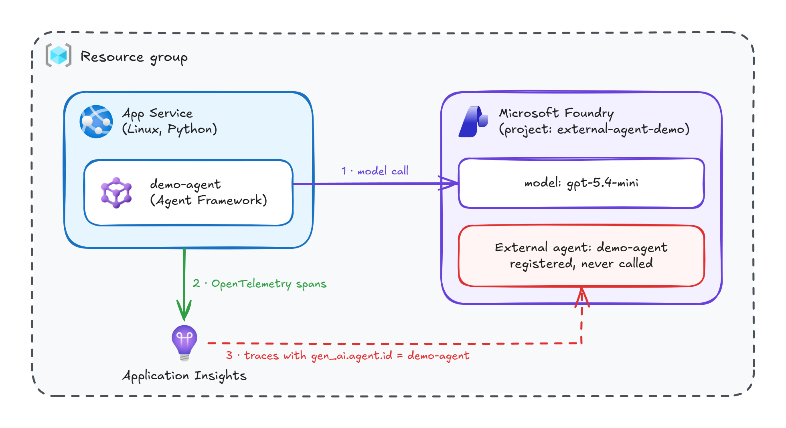

# How to link an external agent to Microsoft Foundry 🔗

> [!NOTE]
> 📖 **Blog article:** [How to link an external agent to Microsoft Foundry](https://www.benjaminbork.com/blog/how-to-link-an-external-agent-to-microsoft-foundry/)

Run your agent on **your own host** and still see it in **Microsoft Foundry**. A Microsoft Agent Framework chatbot in a FastAPI app on App Service calls a model in Foundry and sends OpenTelemetry spans to Application Insights. Bicep registers it as an **external agent** in the Foundry project, so Foundry shows its traces. No API keys: the App Service managed identity gets the **Foundry User** role.



## Run 🚀

```bash
azd auth login
```

```bash
azd up
```

## Clean up 🧹

```bash
azd down --purge
```
